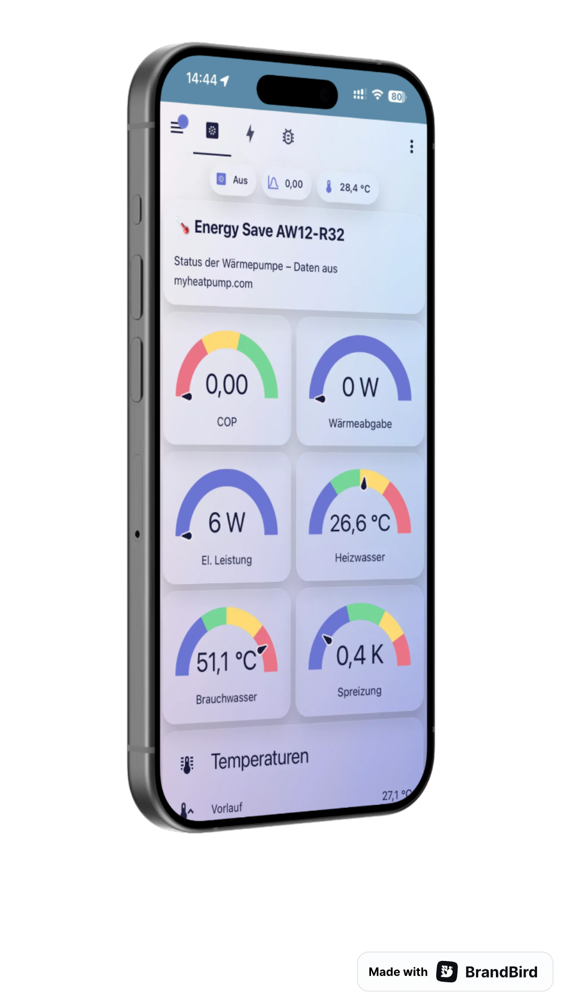

# ES Heatpump – Home Assistant Integration

[](https://hacs.xyz)
[](https://www.home-assistant.io)
[](LICENSE)
[](https://github.com/WombatFirst220/ha-es-heatpump/releases)

> 🇩🇪 [Deutsch](#-deutsch) · 🇬🇧 [English](#-english) · 📋 [Changelog](#-changelog)
>
> ⚠️ **Update auf 4.0.0:** Die Zustände der Betriebsart und der Auswahllisten sind jetzt sprachneutrale Schlüssel — Automationen und Templates prüfen, siehe [Breaking Changes in 4.0.0](#-breaking-changes-in-400). · *Updating to 4.0.0: state values changed, see [breaking changes](#-breaking-changes-in-400-english).*

<p align="center">
  
  <br>
  
</p>

---

<a id="deutsch"></a>
## 🇩🇪 Deutsch

Home Assistant Integration für **Energy Save Wärmepumpen** (Valtop AW12-R32 u.a.) über das [myheatpump.com](https://www.myheatpump.com) Portal.

### ✨ Was die Integration leistet

- 🔐 Automatischer Login + Session-Management (Re-Login alle 55 min)
- 🔍 Automatische Geräteerkennung (`mn` + `devid` aus dem Portal)
- 📊 **Verifizierte** Sensoren mit klaren Namen (siehe [Sensor-Tabelle](#-sensoren))
- ⚡ Berechnete Werte: **Spreizung**, **Thermische Leistung**, **Aktueller COP**
- 📋 Dashboard wird automatisch in der Seitenleiste installiert — mit
  animiertem **Hydraulik-Schema** und wahlweise im **Origami-Design** (seit v3.1.0)
- 🧹 Saubere Entity-IDs (`sensor.es_hp_*`) — keine kryptischen Parameter-Nummern
- 🎛 **Einstellungen der Anlage direkt in Home Assistant** — 70 bedienbare Parameter
  aus dem Portal als `number`, `select` und `switch` (seit v3.0.0)
- 💾 **Versionierte Konfigurationssicherung** — jeder Stand vollständig, jederzeit
  einsehbar und wiederherstellbar (seit v3.0.0)
- 🏷 **Stammdaten der Anlage** — Modell, beide Seriennummern, Inbetriebnahme,
  Garantieende, Installateur (seit v3.0.0)
- 📈 **Alles langzeitfähig** — jede Einstellung ist eine eigene Entity mit
  Verlauf; Textzustände (Betriebsart, Modell, Auswahllisten) ebenfalls
- 📊 **Auswertungsseite** — Strom, Wärme, Arbeitszahl, Verdichtertakte und
  Außentemperatur je Tag, Woche, Monat und Jahr, mit Vorher/Nachher-Vergleich
  bei Einstellungsänderungen (seit v4.0.0, siehe [Auswertung](#-auswertung-seit-v400))
- 🔌 **Energiezähler** in kWh (gesamt, Heizen, Warmwasser) — auch im
  Energie-Dashboard von Home Assistant nutzbar (seit v4.0.0)
- 🛠 Mehrsprachig: Deutsch, Englisch, Niederländisch, Schwedisch, Dänisch (Fallback auf Englisch) —
  seit v4.0.0 auch Entity-Namen und Zustände

### 📦 Installation via HACS

1. **HACS öffnen** → ⋮ → **Benutzerdefinierte Repositories**
2. URL: `https://github.com/WombatFirst220/ha-es-heatpump` · Kategorie: **Integration**
3. Suche nach **ES Heatpump** → **Herunterladen**
4. **Home Assistant neu starten**

### ⚡ Einrichtung

**Einstellungen → Geräte & Dienste → Integration hinzufügen → „ES Heatpump"**

| Feld | Beschreibung |
|---|---|
| **Benutzername** | E-Mail-Adresse beim myheatpump.com Portal |
| **Passwort** | Portal-Passwort |
| **Portal-URL** | Standard: `https://www.myheatpump.com` |
| **Aktualisierungsintervall** | Sekunden (10–3600, Default 60) |
| **Power-Entity** *(optional)* | Sensor mit der elektrischen Leistung (z.B. Shelly) — wird für die COP-Berechnung benötigt |
| **Volumenstrom Heizkreis** | m³/h — **unbedingt an das eigene Modell anpassen**, siehe Tabelle unten |
| **Volumenstrom Brauchwasser** *(optional)* | m³/h für den Speicherkreis (Default 1.0) |
| **Brauchwasser-Schwelle** *(optional)* | K über dem Heizen-Sollwert, ab dem auf Brauchwasser erkannt wird (Default 8) |
| **Betriebsart-Quelle** *(optional)* | Seit v2.3.0 nicht mehr nötig — nur noch als Übersteuerung, falls eine externe Entity die Betriebsart besser kennt |

Nach dem Speichern erscheinen alle Entitäten im Geräte-Eintrag, und das Dashboard **„ES Heatpump"** in der Seitenleiste.

#### ⚠️ Den Volumenstrom richtig einstellen

**Das ist die mit Abstand häufigste Fehlerquelle.** Die Wärmepumpe misst ihren
Volumenstrom nicht und meldet ihn auch nicht über das Portal. Thermische
Leistung und COP werden deshalb daraus **berechnet**:

```
P_therm [W] = Volumenstrom [m³/h] × Spreizung [K] × 1163
COP         = P_therm / elektrische Leistung
```

Ein zu niedrig eingestellter Wert macht beide Größen wertlos — und das fällt
nicht auf, weil die Zahlen plausibel aussehen. Richtwerte aus dem Datenblatt
der Serie, Zeile **„Zulässiger Wasserdurchfluss Min / Nominal"**:

| Modell | Min | **Nominal** |
|---|---:|---:|
| AWC6-R32-M-V8  | 0,65 m³/h | **1,01 m³/h** |
| AWC9-R32-M-V8  | 0,94 m³/h | **1,55 m³/h** |
| AWC12-R32-M-V8 | 1,44 m³/h | **2,02 m³/h** |
| AWC15-R32-M-V8 | 2,23 m³/h | **2,59 m³/h** |
| AWC19-R32-M-V8 | 2,66 m³/h | **3,28 m³/h** |

*(Datenblatt in l/s: 0,18/0,28 · 0,26/0,43 · 0,40/0,56 · 0,62/0,72 · 0,74/0,91 —
hier auf m³/h umgerechnet.)*

Am genauesten ist der Wert, den die Umwälzpumpe selbst anzeigt oder den der
hydraulische Abgleich festgehalten hat. Ohne diese Angabe ist der **Nominalwert**
die richtige Wahl.

**Gegenprobe:** Ein COP unter 1 ist physikalisch unmöglich — die Maschine gäbe
weniger Wärme ab, als sie Strom aufnimmt. Tritt das auf, ist der Volumenstrom zu
niedrig. Seit v2.3.0 schreibt die Integration in diesem Fall einmal pro Neustart
eine Warnung ins Log. Zur Einordnung: Bei 2,02 m³/h, 2,8 K Spreizung und 1350 W
elektrisch ergibt sich COP 4,86 — das Datenblatt nennt für eine AWC12 bei
Wasser 30/35 °C und 7 °C Außentemperatur einen COP zwischen 4,30 und 4,90.

#### 🌀 Geregelte Umwälzpumpe: wann die Konstante nicht reicht

Die Konstante oben stimmt nur, wenn die Umwälzpumpe **mit fester Drehzahl**
läuft. Steht sie auf Automatik oder Proportionaldruck, erhöht sie den
Volumenstrom mit steigender Last — die Konstante ist dann an genau einem
Betriebspunkt richtig und überall sonst falsch.

**Woran man das erkennt, ohne an die Pumpe zu gehen:** Bei festem Volumenstrom
muss die Spreizung mit der Verdichterleistung mitwachsen. Tut sie das nicht,
regelt die Pumpe mit. Beispiel aus einer realen Anlage (ESP III 25-6-180 auf
„Auto"), über zehn Stunden:

| Lastbereich | elektrisch | Spreizung |
|---|---:|---:|
| unteres Drittel | 886 W | 2,15 K |
| mittleres Drittel | 1333 W | 3,25 K |
| oberes Drittel | **2307 W** | **3,10 K** |

Zwischen mittlerem und oberem Drittel steigt die Leistung um 73 %, die
Spreizung aber nicht. Bei konstantem Volumenstrom müsste sie es.

**Zwei Wege, damit umzugehen:**

1. **Volumenstrom-Sensor eintragen** (seit v2.3.1, Feld „Volumenstrom-Sensor").
   Ein gemessener Wert hat Vorrang vor beiden Konstanten. Erkannte Einheiten:
   `m³/h`, `l/min`, `l/h`, `l/s` — andere werden als m³/h gewertet und im
   Attribut `flow_quelle` als solche benannt.
2. **Pumpe auf feste Drehzahl stellen.** Dann gilt die Konstante wieder, und
   der Wärmepumpenkreis bekommt den definierten Durchfluss, für den er ausgelegt
   ist. Welche Stufe die richtige ist, sagt die Auslegung bzw. der hydraulische
   Abgleich.

Ohne eines von beiden bleibt der COP eine **Größenordnung, kein Messwert**: am
Auslegungspunkt richtig, bei Teillast tendenziell zu hoch, bei Volllast zu
niedrig.

#### 🔄 Betriebsart (seit v2.4.0 aus dem Gerät)

**Die Wärmepumpe meldet ihre Betriebsart selbst — in `par1`.** Die
Formularseite des Portals (`/a/amt/realdata/form`) benennt das Feld als
„Unit Current Working Mode" und liefert die Bedeutungen als
Auswahlmöglichkeiten gleich mit:

| `par1` | Portal-Bezeichnung | Integration (Anzeige) | Zustand (seit v4.0.0) |
|---:|---|---|---|
| 0 | Standby | Aus | `off` |
| 1 | Sanitary Hot Water | Brauchwasser | `dhw` |
| 2 | Heating | Heizen | `heating` |
| 3 | **Cooling** | Kühlen | `cooling` |
| 4 | Sanitary Hot Water + Heating | Brauchwasser + Heizen | `dhw_heating` |
| 5 | Sanitary Hot Water + Cooling | Brauchwasser + Kühlen | `dhw_cooling` |
| – | (Abtauen, siehe unten) | Entfrosten | `defrost` |
| – | (nicht bestimmbar) | Unbekannt | `unknown` |

`par1` steckt im selben JSON-Endpunkt, den die Integration seit jeher abruft —
es war nur nie zugeordnet. Bis v2.2.0 galt `par15` als Betriebsart (es ist ein
Herzschlagsignal), bis v2.3.1 wurde sie aus Frequenz, Spreizung und Vorlauf
abgeleitet.

⚠️ **Wer von v2.3.x kommt:** In der alten Zuordnung stand `3 = Entfrosten`.
Richtig ist **Kühlen**. Bei einem Gerät im Kühlbetrieb meldete die Integration
also Abtauen — und setzte damit thermische Leistung und COP auf 0.

**Rangfolge:** `par1` → externe `mode_source_entity` (nur falls `par1` fehlt) →
Ableitung aus eigenen Werten. Die Hilfs-Entity aus v2.2.x wird nicht mehr
gebraucht und kann in den Optionen geleert werden.

**Entfrosten kennt das Portal nicht.** Abtauen ist keine Betriebsart, sondern ein
Vorgang innerhalb des Heizbetriebs: `par1` meldet weiter „Heating", während die
Maschine dem Heizwasser Wärme *entzieht*. Die Integration erkennt das an der
negativen Spreizung (Vorlauf unter Rücklauf) und korrigiert die Betriebsart —
die Ableitung aus v2.3.0 ergänzt `par1` also, statt ersetzt zu werden.

#### 🔄 Ableitung als Rückfallebene (seit v2.3.0)

Das Portal liefert kein brauchbares Betriebsart-Feld — `par15` sah danach aus,
ist aber ein Herzschlagsignal. Bis v2.2.x musste die Betriebsart deshalb aus
einer externen Hilfs-Entity kommen. Seit v2.3.0 leitet die Integration sie aus
den eigenen Werten ab, in dieser Reihenfolge:

| # | Bedingung | Betriebsart |
|---|---|---|
| 1 | keine Kompressorfrequenz in den Daten | Unbekannt (`unknown`) |
| 2 | Kompressorfrequenz = 0 | Aus (`off`) |
| 3 | Vorlauf kälter als Rücklauf (Spreizung ≤ −0,5 K) | Entfrosten (`defrost`) |
| 4 | Vorlauf > Heizen-Soll + Schwelle (Default 8 K) | Brauchwasser (`dhw`) |
| 5 | sonst | Heizen (`heating`) |

Entscheidend ist Regel 4: Verglichen wird gegen den **Sollwert**, nicht gegen
eine feste Temperatur. Bei Warmwasserbereitung treibt die Maschine den Vorlauf
weit über das, was der Heizkreis gerade anfordert — und das gilt für
Fußbodenheizung (Vorlauf ≈33 °C) genauso wie für Heizkörper (≈50 °C). Eine
absolute Schwelle würde bei einer der beiden Anlagenarten danebenliegen.

Regel 3 steht bewusst vor Regel 4: Beim Abtauen läuft der Kreisprozess rückwärts,
der Vorlauf kann dabei hoch sein, ohne dass Warmwasser bereitet wird.

Der Sensor `sensor.…_betriebsart` legt seine Entscheidung offen — das Attribut
`begruendung` nennt die Regel, die gegriffen hat, dazu Vorlauf, Rücklauf,
Sollwert und Frequenz. Wer die Erkennung übersteuern will, trägt weiterhin eine
`Betriebsart-Quelle` in den Optionen ein; sie hat Vorrang.

### 🌡️ Sensoren

#### ✅ Verifizierte Hauptsensoren (sichtbar by default)

| Entity-ID | par | Bedeutung | Einheit | Verifikation |
|---|---|---|---|---|
| `sensor.es_hp_aussentemp_ta` | par24 | Außentemperatur | °C | r=+1.00 ggü. Multiscrape |
| `sensor.es_hp_vorlauf_tuo`   | par4  | Vorlauftemperatur | °C | r=+0.96 |
| `sensor.es_hp_ruecklauf_tui` | par5  | Rücklauftemperatur | °C | r=+0.95 |
| `sensor.es_hp_heizen`        | par8  | Heizwasser-Temperatur | °C | r=+0.98 |
| `sensor.es_hp_heizen_soll`   | par6  | Heizen Solltemperatur | °C | Portal-Sollwert |
| `sensor.es_hp_warmwasser_tw` | par7  | Warmwasser-Temperatur | °C | Portal „Sanitary HW Tw" |
| `sensor.es_hp_raumtemperatur`| par11 | Raumtemperatur | °C | Portal „Room Temp. TR" |
| `sensor.es_hp_mischventil_1` | par9  | Mischventil 1 Temperatur | °C | Portal |
| `sensor.es_hp_aussentemp_ta` | par24 | Außentemperatur | °C | r=+1.00 |
| `sensor.es_hp_heissgas_td`   | par25 | Heißgastemperatur ⚡ neu identifiziert | °C | r=+0.998, MAD=0.35 K |
| `sensor.es_hp_frequenz_hz`   | par20 | Kompressor Frequenz | Hz | r=+0.98 |
| `sensor.es_hp_betriebsart`   | par15 | Betriebsmodus (0=Aus, 1=Heizen) | – | Portal |
| `sensor.es_hp_spannung`      | par31 | Netzspannung | V | Portal |
| `sensor.es_hp_ah_betriebszeit` | par41 | AH Betriebszeit | min | Portal-Counter |
| `sensor.es_hp_hbh_betriebszeit` | par42 | HBH Betriebszeit | min | Portal-Counter |

#### 🧮 Berechnete Sensoren

| Entity-ID | Berechnung |
|---|---|
| `sensor.es_hp_spreizung` | `Vorlauf − Rücklauf` (Δ T des Heizkreises) |
| `sensor.es_hp_thermische_leistung` | `flow_rate × Δ T × 1163 Wh/(m³·K)` — gibt 0 W aus, wenn Kompressor steht |
| `sensor.es_hp_aktueller_cop` | `Thermische Leistung / Elektr. Leistung` (benötigt Power-Entity) |

#### 🔌 Energiezähler (seit v4.0.0)

Die Wärmepumpe liefert Leistungen (W), keine Arbeit (kWh). Für Tages-, Wochen-,
Monats- und Jahreswerte legt die Integration deshalb eigene Zähler an
(`state_class: total_increasing`). Home Assistant verdichtet sie in seiner
Langzeitstatistik — die Auswertungsseite liest diese Statistik.

| Entity-ID | Inhalt | Einheit |
|---|---|---|
| `sensor.es_hp_energie_elektrisch` | Strom gesamt (benötigt Power-Entity) | kWh |
| `sensor.es_hp_energie_elektrisch_heizen` | Strom im Heizbetrieb (inkl. Abtauen) | kWh |
| `sensor.es_hp_energie_elektrisch_warmwasser` | Strom für Warmwasser | kWh |
| `sensor.es_hp_energie_thermisch` | Wärme gesamt | kWh |
| `sensor.es_hp_energie_thermisch_heizen` | Wärme im Heizbetrieb | kWh |
| `sensor.es_hp_energie_thermisch_warmwasser` | Wärme für Warmwasser | kWh |
| `sensor.es_hp_verdichter_starts` | Verdichterstarts (Wechsel `par20` 0 → > 0) | – |
| `sensor.es_hp_verdichter_laufzeit` | Laufzeit des Verdichters | h |

- **Strom** wird aus der konfigurierten Power-Entity integriert (Wert gilt bis
  zur nächsten Änderung, zusätzlich jede Minute fortgeschrieben; kW wird
  umgerechnet). Ohne Power-Entity sind die drei Stromzähler „nicht verfügbar“.
- **Stromzähler** (seit v4.0.1, Option *Stromzähler der Wärmepumpe*): Ist ein
  Energiezähler in kWh gewählt (z. B. `sensor.shelly…_total_active_energy`),
  übernehmen die Stromzähler dessen Zuwächse statt die Leistung zu
  integrieren — genauer, und Neustarts gehen nicht verloren. Wh/MWh werden
  umgerechnet, ein Zählerreset wird erkannt und nicht als Verbrauch gezählt.
- **Wärme** wird bei jedem Portalabruf aus der thermischen Leistung integriert
  (Trapezregel) — sie ist also nur so genau wie der eingestellte
  **Volumenstrom**.
- **Aufteilung** nach der Betriebsart zu Beginn jedes Intervalls. Kühlen und
  Bereitschaft zählen nur zur Gesamtsumme.
- **Lücken** (HA-Neustart, Portal-Ausfall) über 10–15 Minuten werden nicht
  geschätzt, sondern ausgelassen. Ein Zähler zählt lieber etwas zu wenig.
- Die Zähler laufen **ab dem Update** — rückwirkend gibt es keine Werte. Die
  Auswertungskarte füllt die Zeit davor (seit v4.0.1) aus der vorhandenen
  Statistik: Strom aus dem Stromzähler bzw. dem Mittel der elektrischen
  Leistung, Wärme aus dem Mittel der thermischen Leistung. Solche Balken sind
  schraffiert und nicht nach Heizen/Warmwasser aufgeteilt; Starts und Laufzeit
  gibt es erst ab dem Update.
- Die Stromzähler eignen sich für das **Energie-Dashboard** von Home Assistant
  (*Einzelne Geräte*). Wer dort schon den Shelly selbst führt, nimmt ihn nicht
  doppelt auf.

#### 🔍 Diagnose (default deaktiviert, einzeln aktivierbar)

Mischventil 2 (`par10`), Software Version (`par37`), HWTBH Betriebszeit (`par43`), sowie sieben Diagnose-Parameter (`par21`, `par22`, `par23`, `par26`, `par27`, `par39`, `par40`), die mit dem Heizzyklus korrelieren aber nicht eindeutig zuordenbar waren. Aktivierbar unter **Einstellungen → Geräte & Dienste → ES Heatpump → Entitäten**.

#### ❌ Nicht angelegt

`par1, par2, par3, par12–par19, par29, par30, par32–par36, par44–par100` — diese Parameter liefern dauerhaft `0.0` ohne erkennbaren Zusammenhang zum Anlagenzustand und werden nicht mehr als Entitäten erzeugt.

### 📋 Dashboard

<p align="center">
  
</p>

Vier Ansichten. Ihr Aufbau hängt vom gewählten Design ab (siehe unten):

| Ansicht | Design *Standard* | Design *Origami* (seit v3.2.0) |
|---|---|---|
| **Übersicht** | Hydraulik-Schema, Messzeiger (COP, Wärmeabgabe, El. Leistung, Heizwasser, Brauchwasser, Spreizung), Temperaturen, 24-h-Verlauf, System-Technik | *Wärmepumpe* mit Schema, *Jetzt*, *Speicher*, *Verlauf · 24 h* als Kacheln |
| **Energie** | COP-Statistik (7 Tage), Wärmeabgabe und Frequenz, Heißgas, Betriebsstunden | *Effizienz*, *Leistung · 24 h*, *Betriebsstunden* |
| **Auswertung** (seit v4.0.0) | Auswertungskarte über die volle Breite | *Auswertung* |
| **Diagnose** | Mischventile, Diagnose-Parameter, Geräteinfo | *Kältekreis*, *Elektrik und Lüfter*, *Diagnose-Parameter* |

Die Integration schreibt das Dashboard bei **jedem Start und jeder
Optionsänderung neu** (Storage-Modus, seit v3.1.1 auch ohne Neustart sichtbar).
Änderungen im UI-Editor gehen dabei verloren. Für eigene Anpassungen das
Dashboard in HA duplizieren. Gelöscht wird es nur, wenn die Integration entfernt
wird.

#### ⚙️ Einstellungen (seit v3.1.1 in Abschnitten)

*Einstellungen → Geräte & Dienste → ES Heatpump → Konfigurieren*. Die
Erklärung zu jedem Feld steht als Hilfetext darunter.

| Abschnitt | Felder |
|---|---|
| **Messung und Berechnung** | Modell, Volumenstrom Heizkreis und Brauchwasserkreis, Stromsensor, Stromzähler (seit v4.0.1), Volumenstrom-Sensor, Schwelle Brauchwasser-Erkennung, Betriebsart-Quelle |
| **Dashboard** | Hydraulik-Schema anzeigen, Design (Standard / Origami) |
| **Schreibzugriff und Sicherungen** *(eingeklappt)* | Schreibzugriff erlauben, Abruf der Einstellungen, automatische Sicherung, aufbewahrte Sicherungen |
| **Verbindung zum Portal** *(eingeklappt)* | Portal-URL, Aktualisierungsintervall |

Vor HA 2024.7 erscheinen dieselben Felder ohne Abschnitte.

#### 📊 Auswertung (seit v4.0.0)

Die Seite **Auswertung** im Dashboard zeigt, was die Wärmepumpe über längere
Zeit geleistet hat — und ob eine Änderung an den Einstellungen etwas gebracht
hat. Grundlage sind die [Energiezähler](#-energiezähler-seit-v400) und die
Langzeitstatistik von Home Assistant, es wird nichts zusätzlich gespeichert.

- **Zeiträume:** Tag (je Stunde), Woche (Mo–So, je Tag), Monat (je Tag), Jahr
  (je Monat) und alle Jahre. Mit ‹ › blättern, Antippen eines Balkens zeigt die
  Werte und springt per „Anzeigen“ eine Ebene tiefer.
- **Diagramm:** Strom und Wärme als gestapelte Balken (Heizen / Warmwasser /
  Sonstiges), dazu Arbeitszahl und Außentemperatur als Linien. Jede Reihe ist
  über die Legende abschaltbar.
- **Kennzahlen:** Strom, Wärme, Arbeitszahl (gesamt, Heizen, Warmwasser),
  Warmwasser-Anteil, Verdichterstarts, Laufzeit, Laufzeit je Start,
  Ø Außentemperatur, Heizgradtage und **Strom je Heizgradtag** (gleicht
  unterschiedlich kalte Zeiträume teilweise aus), Ø Vorlauf. Jede Kennzahl mit
  Veränderung gegenüber dem gleich langen Vorzeitraum.
- **Einstellungsänderungen:** Aus aufeinanderfolgenden
  [Konfigurationssicherungen](#-versionierte-konfigurationssicherung) leitet die
  Integration ab, wann sich welche Einstellung geändert hat. Die Zeitpunkte
  stehen als Markierung im Diagramm und als Liste darunter.
- **Vorher / Nachher:** Ein Klick auf eine Änderung vergleicht 3, 7, 14 oder
  30 volle Tage davor und danach (Arbeitszahl, Strom und Wärme je Tag, Strom je
  Heizgradtag, Starts je Tag, Laufzeit je Start, Außen- und Vorlauftemperatur).
  Hinweise erscheinen, wenn der Zeitraum danach noch unvollständig ist, die
  Außentemperatur deutlich abweicht oder im Fenster weitere Änderungen lagen.

Die Karte heißt `custom:es-heatpump-analysis-card` und wird von der Integration
immer geladen — sie lässt sich also auch in eigene Dashboards einbauen:

```yaml
type: custom:es-heatpump-analysis-card
default_view: month        # day | week | month | year | all
heating_base_temp: 15      # Basis der Heizgradtage in °C
# entities:                # nur bei abweichenden Entity-IDs
#   el: sensor.es_hp_energie_elektrisch
```

Die **Arbeitszahl** ist hier Wärme ÷ Strom über den Zeitraum — aussagekräftiger
als der Momentan-COP. Sie hängt an der Strommessung und am eingestellten
Volumenstrom; ein falscher Volumenstrom verschiebt alle Werte gleichmäßig.
Seit v4.0.1 zählen nur Stunden mit Strom *und* Wärme, und Tage mit einer
Arbeitszahl unter 1 (physikalisch unmöglich, meist ein zu niedriger
Volumenstrom) bleiben außen vor (hohler Punkt, Hinweis unter dem Diagramm).
Der Vergleich mit dem Vorzeitraum erscheint nur, wenn dieser mindestens 80 %
der Datenabdeckung hat.
Die Einstellungsänderungen sind nur so fein wie die Sicherungen (Standard:
alle 24 h, außerdem vor jedem Schreibzugriff).

**Historie vor dem Update (seit v4.0.1):** Die Energiezähler gibt es erst ab
dem Update auf v4.0.0 — die Karte war davor leer. Jetzt wählt sie die Quelle je
Balken: Deckt die Statistik der Zähler einen Balken vollständig ab, gelten die
Zähler. Sonst kommt der **Strom** aus dem Stromzähler (Option *Stromzähler der
Wärmepumpe*, Zuwachs laut Langzeitstatistik) oder — geschätzt — aus dem Mittel
von `sensor.es_hp_leistung_elektrisch` × Stunden, die **Wärme** aus dem Mittel
von `sensor.es_hp_thermische_leistung` × Stunden. Summiert wird immer die
Stundenstatistik: Stunden ohne Daten zählen nicht, es wird nichts hochgerechnet.
Solche Balken sind nicht nach Heizen/Warmwasser aufgeteilt (geschätzte
schraffiert), Starts und Laufzeit fehlen dort; ein Hinweis unter dem Diagramm
nennt die Quellen. Wer einen Shelly o. ä. an der Wärmepumpe hat, sollte ihn
unter **Optionen → Messung und Berechnung → Stromzähler der Wärmepumpe**
eintragen: Er ist genauer als das Leistungsmittel und reicht meist weiter
zurück. Welche Entities die Karte liest, erfragt sie über den WebSocket-Befehl
`es_heatpump/analysis_config` (umbenannte Entities werden über die `unique_id`
gefunden); `entities:` in der Kartenkonfiguration hat Vorrang, der Stromzähler
heißt dort `meter`.

#### 🔀 Hydraulik-Schema (seit v3.1.0)

Ganz oben in der Übersicht steht das animierte Anlagenschema der
[Heat Pump Hydraulic Card](https://github.com/Sturmi77/heatpump-hydraulic-card)
von Sturmi77. Aufgebaut ist es wie das Anlagenschaubild im Portal:
Wärmepumpe → Umschaltventil → Warmwasserspeicher (TW) bzw. Pufferspeicher (TC)
→ Heizkreis, dazu der Kältekreis (Heißgas, Sauggas, Hoch-/Saugdruck,
Expansionsventil) im Detailbereich.

- **Nichts nachzuinstallieren:** Die Karte (v0.18.0, MIT-Lizenz) wird mit der
  Integration ausgeliefert und von ihr geladen.
- **Eigene Installation hat Vorrang:** Ist die Karte schon über HACS bzw. den
  Marktplatz als Lovelace-Ressource eingebunden, lädt die Integration ihre Kopie
  nicht. Es läuft dann die eigene, gegebenenfalls neuere Version.
- **Nur lesend:** Das Schema hat keine Bedienelemente. Schreiben in die Anlage
  bleibt eine bewusste Entscheidung über „Schreibzugriff erlauben“.
- **Abschaltbar:** Option „Hydraulik-Schema im Dashboard anzeigen“. Dann wird
  die Karte auch nicht mehr geladen (≈ 520 KB JavaScript weniger je Seitenaufruf).

#### 🎨 Design „Origami“ (seit v3.1.0)

Option „Design des Dashboards“: **Standard** übernimmt das Theme des Benutzers.
**Origami** baut das Dashboard im Stil von
[Origami](https://github.com/hazymorning/origami) (hazymorning) um, seit v3.2.0
mit eigenem Aufbau: Abschnitte mit Überschriften (*Wärmepumpe* mit Schema,
*Jetzt*, *Speicher*, *Verlauf*; auf den anderen Seiten *Effizienz*, *Leistung*,
*Kältekreis* …) und farbige Kacheln statt Messzeigern. Am Handy steht alles
untereinander, am Desktop in drei Spalten. Verwendet werden nur Karten, die
Home Assistant mitbringt. Nötig ist HA 2024.10 oder neuer. Dazu kommt das Theme
Origami als View-Theme. Andere Dashboards bleiben unberührt.

Das Theme selbst wird **nicht** mitgeliefert. Origami steht unter der AGPL-3.0,
diese Integration unter MIT. Ein Mitliefern wäre zwar erlaubt, solange die Datei
unter ihrer eigenen Lizenz bleibt. Dann wäre das Paket aber gemischt lizenziert,
und das Theme bekäme keine Updates aus seinem Repository. Die Integration spricht
das Theme deshalb nur über seinen Namen an. Installieren lässt es sich so:

1. Marktplatz/HACS → [Origami öffnen](https://my.home-assistant.io/redirect/hacs_repository/?owner=hazymorning&repository=origami&category=theme)
   (Kategorie *Theme*) → herunterladen.
2. In `configuration.yaml` muss `frontend: themes: !include_dir_merge_named themes` stehen.
3. Entwicklerwerkzeuge → Aktionen → `frontend.reload_themes`.
4. *Optional:* die Schrift Montserrat wie in der
   [Origami-Anleitung](https://github.com/hazymorning/origami#theme) beschrieben
   einbinden. Ohne sie greift die Systemschrift.

Ist Origami gewählt, aber nicht installiert, erscheint unter *Einstellungen →
Reparaturen* ein Hinweis. HA zeigt bis dahin das Standard-Theme. Nach
`frontend.reload_themes` verschwindet der Hinweis ohne Neustart.

### ⚠️ Breaking Changes in 4.0.0

Entity-Namen und Zustände sind seit 4.0.0 echte Home-Assistant-Übersetzungen
([Issue #6](https://github.com/WombatFirst220/ha-es-heatpump/issues/6)). Damit
das in jeder Sprache funktioniert, sind die **Zustandswerte** jetzt sprachneutrale
Schlüssel. In der Oberfläche steht weiterhin der übersetzte Text („Heizen“,
„Heating“ …) — **Automationen, Skripte und Templates** sehen aber den Schlüssel.

**Unverändert:** alle Entity-IDs und `unique_id`s, Verlauf und
Langzeitstatistik, Zahlenwerte und Schalter.

**Betriebsart** (`sensor.es_hp_betriebsart`):

| bis 3.2.0 | ab 4.0.0 |
|---|---|
| `Aus` | `off` |
| `Brauchwasser` | `dhw` |
| `Heizen` | `heating` |
| `Kuehlen` | `cooling` |
| `Brauchwasser + Heizen` | `dhw_heating` |
| `Brauchwasser + Kuehlen` | `dhw_cooling` |
| `Entfrosten` | `defrost` |
| `Unbekannt` | kein Wert – HAs eigener Zustand `unknown` |

**Auswahllisten** (`select.es_hp_cfg_*`) — gilt für den Zustand *und* für
`select.select_option`:

| Entity | bis 3.2.0 | ab 4.0.0 |
|---|---|---|
| `select.es_hp_cfg_par4` Betriebsart | `Bereitschaft` · `Heizen` · `Kühlen` · `Warmwasser` · `Automatik` | `standby` · `heating` · `cooling` · `dhw` · `auto` |
| `select.es_hp_cfg_par9` Umschaltung Heizen/Kühlen | `Deaktiviert` · `Außentemperatur` · `Externes Signal` · `Externes Signal + Außentemperatur` | `disabled` · `ambient` · `external` · `external_ambient` |
| `select.es_hp_cfg_par49` / `par51` Vorrang Zusatzheizung | `Niedriger als Wärmepumpe` · `Höher als Wärmepumpe` | `lower_than_heatpump` · `higher_than_heatpump` |
| `select.es_hp_cfg_par86` Displaybeleuchtung | `Dauernd an` · `3 Minuten` · `5 Minuten` · `10 Minuten` | `always_on` · `min_3` · `min_5` · `min_10` |
| `select.es_hp_cfg_par5` Sprache der Bedieneinheit | Sprachname (`Deutsch`, `English` …) | `lang_<Portalwert>`, z. B. `lang_2` = Deutsch, `lang_0` = English |

**Was anzupassen ist:**

```yaml
# vorher
condition: state
entity_id: sensor.es_hp_betriebsart
state: "Heizen"
# nachher
condition: state
entity_id: sensor.es_hp_betriebsart
state: "heating"
```

```yaml
# vorher
action: select.select_option
target: { entity_id: select.es_hp_cfg_par4 }
data: { option: "Warmwasser" }
# nachher
action: select.select_option
target: { entity_id: select.es_hp_cfg_par4 }
data: { option: "dhw" }
```

In Templates entsprechend `is_state('sensor.es_hp_betriebsart', 'heating')`.
Wer den angezeigten Text braucht, nimmt `state_translated('sensor.es_hp_betriebsart')`
(HA 2024.3+). Im Verlauf erscheinen ältere Einträge mit dem alten deutschen Wert.

**Angezeigte Namen:** Die Namen folgen der in Home Assistant eingestellten
Sprache. Einstellungen, *Anlagendaten*, *Konfigurationssicherungen* und der
Knopf *Konfiguration jetzt sichern* heißen jetzt wie die Messwerte „Gerätename +
Name“ (z. B. „ES Wärmepumpe Schnelleinstellung: Betriebsart“ statt „WP Schnelleinstellung: Betriebsart“). Wer einen Namen
von Hand vergeben hat, behält ihn.

### 🔄 Migration von v1.x → v2.0.0

**Beim ersten Start nach dem Update** läuft eine einmalige Migration:

1. Alte Entity-IDs (`sensor.es_warmepumpe_*`) werden anhand der `unique_id` (z.B. `..._par24`) auf die neuen `sensor.es_hp_*`-IDs umgeschrieben — **History und Statistiken bleiben erhalten**.
2. Verwaiste „Parameter parXX"-Entitäten (par1, par2, …) werden aus dem Entity-Register entfernt.
3. Das Dashboard-YAML wird auf v2 überschrieben.

**Wichtig:** Wenn du Automationen oder Skripte hast, die alte Entity-IDs referenzieren, musst du diese manuell auf das neue Schema umstellen. Eine Übersicht aller Renames findest du in [`PARAMETER_MAPPING.md`](PARAMETER_MAPPING.md).

### 🐛 Fehlerbehebung

| Problem | Lösung |
|---|---|
| „Anmeldung fehlgeschlagen" | Zugangsdaten im Portal prüfen |
| Sensoren `unavailable` | Netzwerk + Portal-Erreichbarkeit prüfen, HA-Logs ansehen |
| Dashboard fehlt | `lovelace.reload_resources` aufrufen, ggf. HA-Neustart |
| Lüfter-Drehzahl fehlt | Der Lüfter-Wert ist nicht im API-Endpoint enthalten — falls benötigt, weiterhin Multiscrape verwenden |
| COP zeigt „unknown" | Power-Entity in den Optionen hinterlegen (Shelly o.ä.) |
| Falscher Wert eines Diagnose-Sensors | GitHub-Issue mit par-ID und beobachteten Werten öffnen |

---

<a id="english"></a>
## 🇬🇧 English

Home Assistant integration for **Energy Save heat pumps** (Valtop AW12-R32 and similar) via the [myheatpump.com](https://www.myheatpump.com) portal.

### ✨ Features

- 🔐 Automatic login + session management (re-login every 55 min)
- 🔍 Automatic device discovery (`mn` + `devid` from the portal)
- 📊 **Verified** sensors with clear names
- ⚡ Calculated values: **Spread (Δ T)**, **Thermal Output**, **Current COP**
- 📋 Sidebar dashboard installed automatically, with an animated **hydraulic
  schematic** (bundled [Heat Pump Hydraulic Card](https://github.com/Sturmi77/heatpump-hydraulic-card), MIT)
  and an optional **Origami** design (theme by [hazymorning](https://github.com/hazymorning/origami),
  AGPL-3.0, not bundled; install it via Marketplace/HACS) — both switchable in the options (since v3.1.0)
- 🧹 Clean entity IDs (`sensor.es_hp_*`)
- 📊 **Analysis view** (since v4.0.0) — electricity, heat, seasonal performance
  factor (SPF), compressor cycling and outdoor temperature per day, week, month
  and year, with a before/after comparison around settings changes
- 🔌 **Energy counters** in kWh (total, heating, hot water) plus compressor
  starts and runtime — usable in the Home Assistant Energy dashboard (since v4.0.0)
- 🛠 Multilingual: German, English, Dutch, Swedish, Danish (falls back to
  English) — since v4.0.0 including entity names and states

### 📦 Installation via HACS

1. **HACS** → ⋮ → **Custom repositories**
2. URL: `https://github.com/WombatFirst220/ha-es-heatpump` · Category: **Integration**
3. Search **ES Heatpump** → **Download**
4. **Restart Home Assistant**

### ⚡ Setup

**Settings → Devices & Services → Add integration → "ES Heatpump"**

| Field | Description |
|---|---|
| Username | E-mail for myheatpump.com portal |
| Password | Portal password |
| Portal URL | Default `https://www.myheatpump.com` |
| Scan interval | Seconds (10–3600, default 60) |
| Power entity *(optional)* | Electrical-power sensor (e.g. Shelly) — used for COP |
| Heating-loop flow rate | m³/h — **must be set for your model**, see table below |
| DHW-loop flow rate *(optional)* | m³/h for the tank circuit (default 1.0) |
| DHW margin *(optional)* | K above the heating setpoint that marks DHW mode (default 8) |
| Operating-mode source *(optional)* | No longer needed since v2.3.0 — only as an override |

#### ⚠️ Getting the flow rate right

**This is by far the most common misconfiguration.** The heat pump neither
measures nor reports its volumetric flow, so thermal output and COP are
**calculated** from the configured value:

```
P_therm [W] = flow rate [m³/h] × spread [K] × 1163
COP         = P_therm / electrical power
```

A value that is set too low makes both figures worthless — and it goes unnoticed
because the numbers still look plausible. Reference values from the series
datasheet, row **"Permissible water flow Min / Nominal"**:

| Model | Min | **Nominal** |
|---|---:|---:|
| AWC6-R32-M-V8  | 0.65 m³/h | **1.01 m³/h** |
| AWC9-R32-M-V8  | 0.94 m³/h | **1.55 m³/h** |
| AWC12-R32-M-V8 | 1.44 m³/h | **2.02 m³/h** |
| AWC15-R32-M-V8 | 2.23 m³/h | **2.59 m³/h** |
| AWC19-R32-M-V8 | 2.66 m³/h | **3.28 m³/h** |

*(Datasheet in l/s: 0.18/0.28 · 0.26/0.43 · 0.40/0.56 · 0.62/0.72 · 0.74/0.91.)*

The most accurate figure is the one your circulation pump displays, or the one
recorded during hydraulic balancing. Without it, use the **nominal** value.

**Sanity check:** a COP below 1 is physically impossible — the machine would be
giving off less heat than the electricity it draws. If you see one, the flow
rate is too low; since v2.3.0 the integration logs a warning once per restart in
that case. For scale: 2.02 m³/h at 2.8 K spread and 1350 W electrical yields
COP 4.86, and the datasheet quotes 4.30–4.90 for an AWC12 at water 30/35 °C and
7 °C ambient.

#### 🌀 Modulating circulation pump: when the constant is not enough

The constant above only holds if the circulation pump runs at a **fixed speed**.
In automatic or proportional-pressure mode it raises the flow as the load rises
— the constant is then correct at exactly one operating point and wrong
everywhere else.

**How to spot it without touching the pump:** with a fixed flow the spread has
to grow with compressor power. If it doesn't, the pump is modulating. Example
from a real installation (ESP III 25-6-180 set to "Auto"), over ten hours:

| Load band | electrical | Spread |
|---|---:|---:|
| lower third | 886 W | 2.15 K |
| middle third | 1333 W | 3.25 K |
| upper third | **2307 W** | **3.10 K** |

From the middle to the upper third the power rises by 73 %, the spread does not.
With a constant flow it would have to.

**Two ways to handle it:**

1. **Configure a flow sensor** (since v2.3.1, field "Live volumetric-flow
   sensor"). A measured value takes precedence over both constants. Recognised
   units: `m³/h`, `l/min`, `l/h`, `l/s` — anything else is taken as m³/h and
   labelled as such in the `flow_quelle` attribute.
2. **Set the pump to a fixed speed.** The constant is then valid again, and the
   heat-pump loop gets the defined flow it was designed for.

Without either, treat the COP as an **order of magnitude, not a measurement**:
right at the design point, on the high side at part load, on the low side at
full load.

#### 🔄 Operating-mode detection (since v2.3.0)

The portal exposes no usable operating-mode field — `par15` looked like one but
is a heartbeat signal. Up to v2.2.x the mode had to come from an external helper
entity. Since v2.3.0 it is derived from the machine's own values, in this order:

| # | Condition | Mode |
|---|---|---|
| 1 | no compressor frequency in the data | `unknown` |
| 2 | compressor frequency = 0 | `off` |
| 3 | flow colder than return (spread ≤ −0.5 K) | `defrost` |
| 4 | flow > heating setpoint + margin (default 8 K) | `dhw` (hot water) |
| 5 | otherwise | `heating` |

(State values since v4.0.0; up to 3.2.0 these were `Unbekannt`, `Aus`,
`Entfrosten`, `Brauchwasser`, `Heizen`.)

Rule 4 compares against the **setpoint**, not a fixed temperature. During hot
water production the machine drives the flow far above whatever the heating
circuit is currently asking for — true for underfloor heating (flow ≈33 °C) and
radiators (≈50 °C) alike, where a fixed threshold would misclassify one of them.

Rule 3 deliberately comes first: during a defrost cycle the refrigeration cycle
runs in reverse, and the flow temperature can be high without any DHW demand.

The `betriebsart` sensor exposes its decision — the `begruendung` attribute names
the rule that fired, alongside flow, return, setpoint and frequency. To override
the detection, configure an operating-mode source entity in the options; it takes
precedence.

### 🌡️ Sensors

The plugin creates around 18 visible entities under `sensor.es_hp_*` plus calculated sensors for **Spread**, **Thermal Output** and **COP**. Diagnostic sensors are registered but disabled by default — enable them under **Settings → Devices & Services → ES Heatpump → Entities**. Unidentified parameters that always return `0.0` are not exposed at all. See the German section above and [`PARAMETER_MAPPING.md`](PARAMETER_MAPPING.md) for the full table with verification details.

### 📋 Dashboard and options (since v3.1)

- The bundled dashboard has four views (Overview, Energy, Analysis since
  v4.0.0, Diagnostics). The
  **Standard** design uses gauges and your own theme. The **Origami** design
  (since v3.2.0) is built from sections with headings and tiles and uses the
  Origami theme as view theme. It needs HA 2024.10 and the theme from
  Marketplace/HACS.
- The **hydraulic schematic** (Heat Pump Hydraulic Card, bundled) sits at the
  top of the overview. If you already load the card as a Lovelace resource,
  your copy wins.
- The integration rewrites the dashboard on every start and options change.
  Duplicate it in HA for your own edits.
- The **options dialog** is split into sections: *Measurement and calculation*,
  *Dashboard*, *Write access and backups* (collapsed) and *Portal connection*
  (collapsed). On HA before 2024.7 the same fields appear without sections.

### 📊 Analysis view and energy counters (since v4.0.0)

New counters (`state_class: total_increasing`): `sensor.es_hp_energie_elektrisch`
(+ `_heizen`, `_warmwasser`; needs the power entity), `sensor.es_hp_energie_thermisch`
(+ `_heizen`, `_warmwasser`; computed from the configured flow rate),
`sensor.es_hp_verdichter_starts` and `sensor.es_hp_verdichter_laufzeit` (h).
Gaps longer than 10–15 minutes are skipped rather than estimated; counting starts
with the update, there is no back-fill.

The dashboard gets a fourth view, **Auswertung** (analysis), built around the
bundled `custom:es-heatpump-analysis-card`. It reads Home Assistant's long-term
statistics: stacked bars for electricity and heat (heating / hot water / other),
SPF and outdoor temperature as lines, KPIs incl. heating degree days and kWh per
degree day, each compared with the previous period of the same length. Settings
changes derived from consecutive configuration backups are marked in the chart;
clicking one compares 3/7/14/30 full days before and after. The card is always
loaded and can be used in your own dashboards (`default_view`,
`heating_base_temp`, `entities` options).

Since v4.0.1 the card also shows the time **before the counters existed**: per
bar it falls back to the configured electricity meter (new option *Heat pump
electricity meter (kWh)*, e.g. the Shelly total energy) or the hourly mean of
the electrical power, and the hourly mean of the thermal power (missing hours
are not extrapolated). Such bars are not split into heating/hot water and have
no starts/runtime. With the meter option set, the electricity counters follow
the meter's increments instead of integrating the power.

<a id="-breaking-changes-in-400-english"></a>
### ⚠️ Breaking changes in 4.0.0

Entity names and states now use native Home Assistant translations
([issue #6](https://github.com/WombatFirst220/ha-es-heatpump/issues/6)). The UI
shows translated text, but **state values are now language-neutral keys** —
update automations, scripts and templates. Entity IDs, unique IDs, history and
statistics are unchanged.

- `sensor.es_hp_betriebsart`: `Aus`→`off`, `Brauchwasser`→`dhw`,
  `Heizen`→`heating`, `Kuehlen`→`cooling`, `Brauchwasser + Heizen`→`dhw_heating`,
  `Brauchwasser + Kuehlen`→`dhw_cooling`, `Entfrosten`→`defrost`,
  `Unbekannt`→ no value (Home Assistant's own `unknown` state).
- `select.es_hp_cfg_*` options (state and `select.select_option`): par4
  `standby/heating/cooling/dhw/auto`; par9 `disabled/ambient/external/external_ambient`;
  par49/par51 `lower_than_heatpump/higher_than_heatpump`; par86
  `always_on/min_3/min_5/min_10`; par5 `lang_<portal value>`. Full old → new
  table in the German section above.
- Names follow your Home Assistant language. Settings entities, the master-data
  and backup sensors and the backup button are now named "device name + name"
  (previously "WP …"). Names you set manually are kept.

### 🔄 Migration from v1.x → v2.0.0

On first start after the update a one-time migration runs:

1. Old entity IDs (`sensor.es_warmepumpe_*`) are renamed to `sensor.es_hp_*` using their `unique_id` as the join key — **history and statistics are preserved**.
2. Orphaned "Parameter parXX" entities are removed from the registry.
3. The dashboard YAML is refreshed to v2.

Update your automations and scripts referring to the old entity IDs accordingly.

---

<a id="changelog"></a>
## 📋 Changelog

### Beim Update auf v2.5.0 oder neuer: „Die Einheit von … hat sich geändert"

Home Assistant meldet nach dem Update bis zu drei Reparaturen:

| Sensor | war | ist |
|---|---|---|
| `sensor.es_hp_hochdruck_pd` | °C | **bar** |
| `sensor.es_hp_saugdruck_ps` | °C | **bar** |
| `sensor.es_hp_comp_speed_berechnet` | Hz | ohne Einheit |

Das ist die Folge der Korrekturen aus v2.5.0 und v2.4.1 — die Felder waren mit
der falschen Einheit angelegt. Home Assistant hat dafür Langzeitstatistiken mit
der alten Einheit und fragt nach.

**Der Reparatur-Dialog bietet nur „Statistiken löschen" an**, weil °C nach bar
keine bekannte Umrechnung ist. Das ist unnötig: **Die gespeicherten Zahlen sind
bereits richtig** — es waren immer die Rohwerte des Portals, also bar. Falsch ist
nur das Etikett.

Statt zu löschen lässt sich die Einheit in den Statistik-Metadaten umschreiben.
Die Werte bleiben dabei unberührt (`update_unit_of_measurement` in
`recorder/table_managers/statistics_meta.py` ist ein reines `UPDATE` auf die
Metadatentabelle).

**Entwicklerwerkzeuge → Aktionen** reichen dafür nicht, es braucht die
WebSocket-API. Ein kurzes Skript mit einem Long-Lived Access Token:

```python
# je Sensor einmal senden
{"type": "recorder/update_statistics_metadata",
 "statistic_id": "sensor.es_hp_hochdruck_pd",
 "unit_of_measurement": "bar",
 "unit_class": "pressure"}

{"type": "recorder/update_statistics_metadata",
 "statistic_id": "sensor.es_hp_saugdruck_ps",
 "unit_of_measurement": "bar",
 "unit_class": "pressure"}

{"type": "recorder/update_statistics_metadata",
 "statistic_id": "sensor.es_hp_comp_speed_berechnet",
 "unit_of_measurement": None,
 "unit_class": None}
```

Danach `{"type": "recorder/update_statistics_issues"}` senden — die Meldungen
verschwinden ohne Neustart.

Wem die Historie dieser drei Werte egal ist, der kann im Dialog auch einfach
löschen. Beim Hochdruck hingen hier 187 Tage daran.

### 4.0.1 — 2026-11-08

- **Auswertung mit Historie:** Die Karte war nach dem Update leer, weil die
  Energiezähler erst ab v4.0.0 zählen. Sie füllt die Zeit davor jetzt aus der
  vorhandenen Langzeitstatistik (Stromzähler bzw. Leistungsmittel, Wärme aus
  dem Mittel der thermischen Leistung, immer stundengenau, ohne Hochrechnung) —
  siehe [Auswertung](#-auswertung-seit-v400). Neuer WebSocket-Befehl
  `es_heatpump/analysis_config`.
- **Neue Option „Stromzähler der Wärmepumpe“** (kWh, z. B. Shelly): Die
  Stromzähler übernehmen dessen Zuwächse statt die Leistung zu integrieren;
  Zählerreset und unplausible Sprünge werden verworfen, ein HA-Neustart geht
  nicht verloren. Das Feld lässt sich wieder leeren.
- **Erneute Anmeldung:** Lehnt das Portal die Zugangsdaten ab, fragt Home
  Assistant nach dem neuen Passwort (bisher blieb die Integration tot). Nur eine
  eindeutige Ablehnung zählt — Wartung, Captcha oder eine unklare Antwort
  führen zu einem neuen Versuch beim nächsten Abruf.
- **Sitzung:** Jeder Eintrag hat eine eigene HTTP-Sitzung (zwei Konten oder
  der Einrichtungsdialog überschrieben sich bisher gegenseitig die Anmeldung).
  Eine vom Portal verworfene Sitzung (Anmeldeseite statt Daten) wird sofort
  erkannt und genau einmal neu angemeldet, statt bis zu 55 Minuten zu scheitern.
  Mess- und Einstellungs-Abruf melden sich nicht mehr parallel an.
- **Portal-URL** aus den Optionen (*Verbindung zum Portal*) wirkt jetzt —
  bisher galt immer die URL der Ersteinrichtung.
- Schreibfehler und ungültige Werte erscheinen mit Begründung statt als
  „Unbekannter Fehler“; Schreibzugriffe laufen nacheinander.
- Spreizung und `par40` als Temperatur*differenz* (zeigten in °C rund
  −268 °C); die Einheit K und die Statistik bleiben.
- Häufig wechselnde Diagnose-Attribute (Betriebsart, COP, thermische Leistung,
  Sicherungsliste) werden nicht mehr in die Recorder-Historie geschrieben.
- Formularkopf (Installateur, Artikelnummer) wird nach einem Fehlschlag erneut
  versucht.
- **Arbeitszahl nur aus gemeinsamen Zeiten:** Die Arbeitszahl (Balken, Linie,
  Kacheln, AZ Heizen/Warmwasser, Vorher/Nachher, Vorzeitraum) entsteht nur noch
  aus Stunden, in denen Strom *und* Wärme vorliegen (bei den Zählern der
  Integration aus dem ganzen Balken). Bisher teilte „Alle Jahre“ z. B. die Wärme
  ab Mai durch den Strom ab Januar (AZ 0,52). Strom- und Wärmebalken zeigen
  weiter die volle Menge.
- **Unplausible Arbeitszahl:** Tage mit mindestens 0,5 kWh Strom und weniger
  Wärme als Strom (AZ < 1, physikalisch unmöglich — meist ein zu niedrig
  eingestellter Volumenstrom) zählen nicht zur Arbeitszahl; der Punkt ist hohl,
  Tooltip und ein Hinweis unter dem Diagramm erklären es.
- **Vorzeitraum-Vergleich** nur noch, wenn der Vorzeitraum mindestens 80 % der
  Datenabdeckung des aktuellen Zeitraums hat (sonst z. B. „Strom +443 %“ gegen
  ein Vorjahr mit Daten erst ab Juli); Fußnote „Vorzeitraum unvollständig“.
- **Portal-Aussetzer:** Ein Konfigurationsstand, in dem Software-/Datenbankversion
  auf 0 fallen oder mindestens die Hälfte der gesetzten Einstellungen
  gleichzeitig 0 wird, gilt als Lesefehler: Die Entities behalten den vorherigen
  Stand, es entsteht keine Sicherung und keine „Änderung erkannt“. Bereits
  gespeicherte Aussetzer erscheinen nicht mehr im Änderungsverlauf und lassen
  sich nicht wiederherstellen.
- Auswertungskarte: auf schmalen Bildschirmen alle sieben Wochentage beschriftet.

*English:* The analysis card now back-fills the time before the v4.0.0 counters
from existing statistics (electricity meter or power mean, thermal power mean,
hourly, no extrapolation); new option for a heat pump electricity meter (kWh);
re-authentication flow; own HTTP session per entry with a single re-login on an
expired session; the portal URL option now takes effect; clearer write errors;
temperature differences no longer shown as −268 °C. The SPF is only computed
from hours with both electricity and heat; days with an SPF below 1 (physically
impossible, usually a wrong flow rate) are excluded and drawn hollow;
previous-period deltas need at least 80 % of the current data coverage; portal
glitches (nearly all configuration values 0) are discarded instead of being
backed up and no longer show up as settings changes.

### 4.0.0 — 2026-11-08

⚠️ **Breaking:** Zustandswerte der Betriebsart und der Auswahllisten sind jetzt
sprachneutrale Schlüssel — siehe [Breaking Changes in 4.0.0](#-breaking-changes-in-400).

- **Übersetzte Entity-Namen und Zustände** ([Issue #6](https://github.com/WombatFirst220/ha-es-heatpump/issues/6)):
  alle Sensoren, Einstellungen, Zustände der Betriebsart und Auswahllisten sowie
  Fehlermeldungen in Deutsch, Englisch, Niederländisch, Schwedisch und Dänisch.
  Entity-IDs und `unique_id`s bleiben unverändert.
- **Neue Installationen** bekommen die Entity-IDs `sensor.es_hp_<slug>` von
  Anfang an (bisher erst über die Migration beim nächsten Start).
- **Energiezähler** für Strom und Wärme (gesamt, Heizen, Warmwasser),
  Verdichterstarts und -laufzeit — siehe [Energiezähler](#-energiezähler-seit-v400).
- **Auswertungsseite** im Dashboard mit eigener Karte, Vorher/Nachher-Vergleich
  bei Einstellungsänderungen — siehe [Auswertung](#-auswertung-seit-v400).
- Neuer WebSocket-Befehl `es_heatpump/settings_changes` (Änderungsverlauf aus
  den Sicherungen).
- Thermische Leistung, COP und Wärmezähler rechnen mit derselben Funktion.
- Ist die Betriebsart nicht bestimmbar, hat der Sensor keinen Wert (HA-Zustand
  `unknown`) statt eines eigenen „Unbekannt“.
- Mindestversion jetzt Home Assistant 2024.2 (übersetzte Fehlermeldungen).

### 3.2.0 — 2026-11-08

**Eigener Aufbau für das Design Origami.** Bisher setzte Origami nur das Theme
auf die alten Ansichten mit Messzeigern. Jetzt sind alle drei Seiten
Abschnitts-Ansichten wie in Origami selbst:

- **Übersicht:** *Wärmepumpe* mit COP und Außentemperatur in der Überschrift
  und dem Hydraulik-Schema darunter. Dazu *Jetzt* (COP, Wärme, Strom,
  Verdichter, Vor-/Rücklauf, Spreizung, Außen), *Speicher* (Warmwasser Ist und
  Soll, Puffer, Heizen Soll, Tup, WP-Fühler) und *Verlauf · 24 h*.
- **Energie:** *Effizienz* (COP, Stundenmittel über 7 Tage), *Leistung · 24 h*
  und *Betriebsstunden*.
- **Diagnose:** *Kältekreis* (Heißgas, Sauggas, Hoch-/Saugdruck,
  Expansionsventil, Lamellentauscher), *Elektrik und Lüfter* und
  *Diagnose-Parameter*.

Die Pfade der Seiten bleiben gleich, Lesezeichen funktionieren also weiter. Es
werden nur Karten verwendet, die Home Assistant mitbringt (Überschrift, Kachel,
Verlauf, Statistik). Nötig ist HA 2024.10. Das Design *Standard* ist
unverändert.

**Korrektur im Standard-Dashboard:** Die Zeile „Heizen Soll (aktiv)“ heißt
jetzt „Wassertemperatur Tup“. par6 ist kein Sollwert, sondern eine gemessene
Wassertemperatur (siehe 3.0.0).

### 3.1.1 — 2026-11-08

**Optionsänderungen am Dashboard wirken sofort.** In v3.1.0 blieb das Dashboard
nach dem Umstellen auf Origami unverändert. Zwei Ursachen, beide seit v2.0.3:

- Lovelace hält jedes Dashboard im Speicher. Die Integration schrieb nur die
  Datei unter `.storage/`, die erst beim nächsten Neustart gelesen wird. Jetzt
  speichert sie über das geladene Dashboard-Objekt, wie der Editor im UI.
- Das Neuladen nach einer Optionsänderung hat das Dashboard gelöscht und unter
  neuer ID neu angelegt. Gelöscht wird es jetzt nur noch, wenn die Integration
  entfernt wird. Eine bereits abweichende ID wird beim Start angeglichen.

**Einstellungsdialog aufgeräumt.** Vier Abschnitte: *Messung und Berechnung*,
*Dashboard*, sowie eingeklappt *Schreibzugriff und Sicherungen* und *Verbindung
zum Portal*. Die Beschriftungen sind kurz, die Erklärungen stehen als Hilfetext
unter dem Feld. Vorher liefen lange Beschriftungen in die Eingabefelder.
Modell und Design sind Optionsfelder statt Dropdowns, denn das Dropdown ließ den
Dialog auf dem iPhone nach oben springen. Ab HA 2024.7, davor wie bisher
ohne Abschnitte.

### 3.1.0 — 2026-11-08

**Hydraulik-Schema im Dashboard.** Die Übersicht zeigt oben das animierte
Anlagenschema der Heat Pump Hydraulic Card (Sturmi77, v0.18.0, MIT). Die Karte
wird mitgeliefert und über einen eigenen statischen Pfad geladen. Wer sie schon
selbst über HACS bzw. den Marktplatz eingebunden hat, behält seine Version, die
Integration lädt dann keine zweite. Zuordnung, Begründungen und was bewusst
fehlt: `dashboard_layout.py`. Abschaltbar über die neue Option
„Hydraulik-Schema im Dashboard anzeigen“ (standardmäßig an).

**Design „Origami“.** Neue Option „Design des Dashboards“ mit *Standard* und
*Origami*. Origami setzt das gleichnamige Theme von hazymorning als View-Theme
auf alle Ansichten dieses Dashboards. Das Theme steht unter der AGPL-3.0 und wird
deshalb nicht mitgeliefert, sondern nur per Name angesprochen. Fehlt es, meldet
die Integration das unter *Reparaturen*. Details im Abschnitt
[Dashboard](#-dashboard).

`manifest.json` nennt jetzt `frontend` und `http` als Abhängigkeiten und
`lovelace` als `after_dependencies`, weil die Integration die Karte selbst
bereitstellt. Neue Tests: `tests/test_dashboard_layout.py`.

### 3.0.2 — 2026-09-22

**Eigenes Symbol.** Ein Rotor über zwei Wasserwellen auf einem Verlauf von
Kaltblau nach Warmorange — kalt oben links, warm unten rechts, in derselben
Richtung, in der die Energie wandert.

Seit Home Assistant 2026.3 genügt dafür ein Ordner `brand/` auf oberster Ebene
der Integration; `manifest.json` bleibt unberührt, und lokale Bilder haben
Vorrang vor dem Brands-CDN. Enthalten sind `icon.png` (256×256) und
`icon@2x.png` (512×512), beide RGBA mit transparenten Ecken. `logo.png` fehlt
absichtlich: Home Assistant fällt für alle Logo-Abrufe auf das Icon zurück, eine
quadratische Kopie wäre nur Ballast.

> Der frühere Weg — ein Pull Request nach `home-assistant/brands` — ist
> geschlossen. Ein Workflow dort schließt PRs, die einen neuen Ordner unter
> `custom_integrations/` anlegen, automatisch.
> [Ankündigung](https://developers.home-assistant.io/blog/2026/02/24/brands-proxy-api)

### 3.0.1 — 2026-09-22

**Alle Einstellungen sind jetzt standardmäßig aktiv.**

In v3.0.0 waren 54 der 74 Einstellungs-Entities abgeschaltet angelegt, um die
Oberfläche nicht zu überladen. Das war die falsche Abwägung: **Eine
abgeschaltete Entity liefert gar keine Daten** — weder an eine
Langzeitstatistik noch an eine externe Zeitreihendatenbank. Ausgerechnet die
Werte, die man über Jahre beobachten will (die fünf Stützstellen jeder
Heizkurve), wären damit die einzigen ohne Verlauf gewesen.

Die Entities tragen `EntityCategory.CONFIG` und stehen deshalb unter
„Konfiguration" auf der Geräteseite, nicht zwischen den Messwerten. Wer einzelne
nicht braucht, schaltet sie in den Entity-Einstellungen ab.

> **Beim Update von v3.0.0:** Bereits abgeschaltet angelegte Entities bleiben
> abgeschaltet — Home Assistant merkt sich das je Entity im Register. Zum
> Nachholen: Geräteseite → „+N Entitäten deaktiviert" → aktivieren, dann die
> Integration neu laden.

### 3.0.0 — 2026-09-22

**Die Integration kann jetzt schreiben — und macht das Schreiben erst sicher.**

Drei Dinge kommen zusammen: die Einstellungen der Anlage in Home Assistant, eine
versionierte Sicherung der gesamten Konfiguration, und die Stammdaten des
Geräts. Dazu eine Korrektur, die einen echten Fehler in der
Betriebsart-Erkennung beseitigt.

#### 💾 Versionierte Konfigurationssicherung

Die Bedieneinheit der Wärmepumpe kennt kein Zurück. Wer eine Heizkurve
verstellt, einen Legionellenschutz abschaltet oder während einer Fehlersuche
zehn Werte anfasst, hat hinterher keine Möglichkeit, den vorherigen Stand
wiederherzustellen — außer aus dem Gedächtnis. Ein Servicetechniker, der „mal
eben etwas probiert", hinterlässt denselben Zustand.

Die Integration hält deshalb den **vollständigen Satz von rund 300
Konfigurationswerten** als Zeitreihe. Jede Sicherung ist ein vollständiger
Stand, kein Delta — eine beschädigte Kette macht sonst alle folgenden
unbrauchbar.

Eine Sicherung entsteht automatisch:

| Anlass | Wann |
|---|---|
| `erstaufnahme` | einmalig bei der Einrichtung |
| `automatisch` | sobald sich **irgendein** Wert geändert hat — auch wenn die Änderung an der Bedieneinheit im Keller gemacht wurde |
| `vor-schreibzugriff` | vor jedem Schreibvorgang aus Home Assistant |
| `vor-wiederherstellung` | bevor eine Wiederherstellung den ersten Wert setzt |
| `manuell` | Knopf „Konfiguration jetzt sichern" oder Dienstaufruf |

**Beim Aufräumen werden die drei Eingriffs-Anlässe nie gelöscht.** Der Stand
*vor* einem Eingriff ist zwangsläufig älter als alles, was danach kam — einem
reinen Zeitfenster fiele genau er als Erstes zum Opfer.

Gespeichert wird über den Store von Home Assistant, also unter
`.storage/es_heatpump.backups_<eintrag>`. Damit landen die Sicherungen in jedem
HA-Backup, ohne dass dafür etwas eingerichtet werden müsste.

#### 🔧 Dienste

| Dienst | Zweck |
|---|---|
| `es_heatpump.sicherung_erstellen` | Stand sichern, mit Bezeichnung und Grund |
| `es_heatpump.sicherungen_auflisten` | Übersicht mit Zeitpunkt, Anlass, Prüfsumme |
| `es_heatpump.sicherung_anzeigen` | eine Sicherung vollständig ansehen — Stammdaten, alle benannten Werte im Klartext, Rohwerte |
| `es_heatpump.sicherungen_vergleichen` | Unterschiede zwischen zwei Ständen oder gegen den jetzigen |
| `es_heatpump.sicherung_wiederherstellen` | zurückschreiben — **standardmäßig als Probelauf** |
| `es_heatpump.sicherung_loeschen` | einzelne Sicherung entfernen |
| `es_heatpump.sicherung_exportieren` | als JSON-Datei ablegen |
| `es_heatpump.parameter_setzen` | einzelnen Wert über seine Portal-Kennung setzen |

Alle lesenden Dienste liefern eine Antwort (`response_variable`). Eine Sicherung
**einsehen**, ohne sie wiederherzustellen, ist der häufigere Fall: Man will
wissen, wie ein Wert vor drei Wochen stand, nicht sechzig Werte zurücksetzen.

#### 🎛 Einstellungen als Entities

Das Portal bietet 74 Felder in 14 Gruppen zum Bearbeiten an — Heizkurven mit je
fünf Stützstellen, Warmwasser, Legionellenschutz, Zusatzheizung, Urlaubsmodus,
EVU-Sperre. Sie erscheinen als `number`, `select` und `switch`.

Standardmäßig sichtbar sind nur die 20 Felder, die man wirklich bedient
(Schnelleinstellung, Warmwasserspeicher, Legionellenschutz, Urlaub). Der Rest ist
angelegt, aber abgeschaltet — einschaltbar über die Entity-Einstellungen.

⚠️ **Zwei getrennte `parXX`-Namensräume.** Das Portal verwendet dieselben
Feldnamen zweimal mit völlig verschiedener Bedeutung:

```
/a/amt/realdata/get   Messwerte       par1 = aktuelle Betriebsart, par4 = Vorlauf Tuo
/a/amt/setdata/get    Einstellungen   par1 = Anlage ein/aus,       par4 = Betriebsart-Vorwahl
```

Deshalb tragen alle Konfigurations-Entities das Präfix `es_hp_cfg_`.

#### 🔒 Schreiben ist standardmäßig aus

Eine Cloud-Integration, die ungefragt in eine Heizung schreiben darf, ist eine
andere Art von Software als eine, die nur liest. Diese Entscheidung gehört dem
Betreiber, nicht der Voreinstellung.

Freigabe unter **Einstellungen → Geräte & Dienste → ES Heatpump → Konfigurieren
→ „Schreibzugriff auf die Anlage erlauben"**. Ohne Freigabe:

- lehnen die Entities jede Änderung mit einer erklärenden Meldung ab,
- verweigern `parameter_setzen` und ein echter Wiederherstellungslauf den Dienst,
- funktioniert alles Lesende unverändert.

Zusätzlich prüft der Katalog **jeden** Wert vor dem Senden gegen Wertebereich und
Auswahlliste. Das ist die letzte Stelle, an der ein Tippfehler noch aufzuhalten
ist; danach steht er in der Anlage.

#### 🏷 Stammdaten der Anlage

Neue Entity `sensor.es_hp_anlagendaten`. Zustand ist das Modell, alles Weitere
hängt als Attribut daran:

| Angabe | Beispiel |
|---|---|
| Modell | `AW12-R32-M-V8` |
| Seriennummer Außengerät | `230101-240117-0042` |
| Seriennummer Innengerät | `230098-240115-0041` |
| MAC | `A1B2C3D4E5F6` |
| Inbetriebnahme | `2024-01-17` |
| Garantie bis / Restjahre | `2029-01-17` / `3.16` |
| Installateur | Name und Kürzel des Fachbetriebs |

**Es gibt zwei Seriennummern**, und das Portal-Feld `devicenum` nennt nur eine.
Die zweite steckt im Freitextfeld `note` (`IG:` Innengerät, `AG:` Außengerät).
Wer ein Ersatzteil fürs Innengerät bestellt, braucht die andere.

Modell, Seriennummer und Firmware-Stand stehen jetzt außerdem im Geräteeintrag
von Home Assistant, sichtbar ohne eine einzige Entity zu öffnen.

#### 🐛 `par6` war nie der Heizen-Sollwert

Das Anlagenschaubild des Portals nennt `par6` **Tup** — eine *gemessene*
Wassertemperatur. Die Historie beweist es:

```
06:08:21   Pumpe P0 = 1    par6 = 32.9    Vorlauf 34.2
06:09:41   Pumpe P0 = 0    par6 = 23.8    Vorlauf 32.3
06:11:02   Pumpe P0 = 0    par6 = 14.2    Vorlauf 32.0
```

18 K in 80 Sekunden, sobald die Umwälzpumpe stehenbleibt, während der Vorlauf
steht. Ein Sollwert tut das nicht.

**Der Fehler war real:** Die Betriebsart-Ableitung verglich `Vorlauf > par6 + 8 K`.
Kurz nach einem Verdichterstart stand `par6` bei 14 °C und der Vorlauf bei 32 °C
— die Ableitung meldete „Brauchwasser", obwohl geheizt wurde.

Verglichen wird jetzt gegen **`par8` (TC, Heizwassertemperatur im Puffer)**. Der
hat die Eigenschaft, die `par6` fehlt: thermische Trägheit. Über sechs Stunden
Historie blieb `par8` zwischen 28,2 und 34,0 °C — auch während einer
Warmwasserladung, bei der der Vorlauf auf 58,2 °C stieg.

Der Vergleich gegen eine Wassertemperatur trägt beide Anlagenarten:
Fußbodenheizung (Vorlauf ~33 °C, TC ~33 °C) und Heizkörper (Vorlauf ~50 °C,
TC ~49 °C) liegen dicht beieinander, während der Abstand bei Warmwasser 20 K und
mehr beträgt. Eine feste Schwelle könnte das nicht — sie müsste unter 50 liegen,
um Heizkörper nicht als Warmwasser zu lesen, und über 50, um Warmwasser
überhaupt zu erkennen.

Die Entity-ID `sensor.es_hp_heizen_soll` **bleibt**, damit Dashboards und
Statistiken nicht brechen. Der Anzeigename heißt jetzt „Wassertemperatur Tup".

#### ✏️ Weitere Korrekturen

- **`par26` ist Ts**, die Sauggastemperatur (war `diag_par26 (unbestätigt)`).
  Zusammen mit `par23` (Ps) ergibt sich die Sauggasüberhitzung — die einzige
  Größe, an der sich eine Kältemittelfüllung beurteilen lässt.
- **`par29` ergänzt**: Ventilator 2. Bei der AW12 dauerhaft 0, größere Geräte der
  Reihe haben zwei.
- **`par28`** heißt jetzt „Ventilator 1 Drehzahl".
- **Aufräumroutine abgesichert:** Der reguläre Ausdruck, der verwaiste
  `parXX`-Entities entfernt, hätte die neuen Konfigurations-Entities erfasst
  (`es_heatpump_<benutzer>_cfg_par55` passte auf `^es_heatpump_(.+)_par(\d+)$`)
  und sie bei **jedem Start** gelöscht.

#### ⚙️ Neue Optionen

| Option | Standard | Bedeutung |
|---|---|---|
| Schreibzugriff erlauben | **aus** | Voraussetzung für alles Schreibende |
| Abstand Konfigurationsabruf | 900 s | Einstellungen ändern sich selten |
| Abstand automatischer Sicherungen | 24 h | Leerlauftakt; Änderungen werden immer sofort gesichert |
| Aufbewahrte Sicherungen | 60 | 0 = unbegrenzt; Eingriffs-Sicherungen zählen nicht mit |

#### 🧪 Tests

`tests/test_settings.py` (11 Prüfungen) und `tests/test_backup.py` (21 Prüfungen)
laufen ohne Home-Assistant-Installation, ebenso wie die bestehenden
`test_mode.py` (10) und `test_flow.py` (7).

```bash
python3 -m pytest tests/ -q
```

### 2.5.0 — 2026-09-22

**Sechs Parameter aus der Bedieneinheit zugeordnet — zwei davon standen mit der
falschen Einheit im Dashboard.**

Grundlage sind Fotos des Anlagenschaubilds und der Diagnoseseiten der
Bedieneinheit, abgeglichen gegen gleichzeitige Abrufe des JSON-Endpunkts.

| Feld | neu | bis v2.4.1 | Beleg |
|---|---|---|---|
| `par22` | **Hochdruck Pd (bar)** | „vermutl. Kondensation Tc" in **°C** | Anzeige 20,6 bar gegen par22 = 20,7–20,9 |
| `par23` | **Saugdruck Ps (bar)** | „vermutl. Sauggas Ts" in **°C** | Anzeige 7,5 bar gegen par23 = 7,4–7,8 |
| `par21` | **Expansionsventil Öffnung** | „vermutl. Kompressor Sollwert" | Anzeige „Open 349" gegen par21 = 349–376 |
| `par27` | **Lamellentauscher Tp (°C)** | „vermutl. Verdampfung Te" | Anzeige 2,5–3,3 gegen par27 = 2,6–3,7 |
| `par28` | **Ventilator Drehzahl (rpm)** | nicht abgebildet | Anzeige 557 und 560 gegen par28 = 557 und 560 |
| `par30` | **Stromaufnahme Verdichter (A)** | nicht abgebildet | par30 × par31 gegen gemessene Wirkleistung: Leistungsfaktor 0,94 |

⚠️ **`par22` und `par23` waren als Temperaturen in °C angelegt.** Wer sie
aktiviert hatte, sah „20,9 °C" für 20,9 bar — die Werte wanderten damit auch in
Temperatur-Statistiken. Jetzt mit `device_class: pressure` und Einheit `bar`.

Die sechs sind **standardmäßig aktiv**: Drücke, Ventilstellung,
Ventilatordrehzahl und Verdichterstrom sind die Größen, mit denen sich ein
Kältekreis beurteilen lässt.

`par26`, `par39` und `par40` heißen jetzt ehrlich „unbestätigt" statt „vermutl.
…". Für `par39` ist belegt, was es **nicht** ist: der Verdichterstrom. Die Probe
`par39 × Spannung` gegen die gemessene Wirkleistung ergab einen Faktor von 2,08,
also einen unmöglichen Leistungsfaktor.

**Kein Volumenstrom.** Weder im Portal noch auf den fünf Diagnoseseiten der
Bedieneinheit noch im Anlagenschaubild gibt es einen Durchflusswert. Für die
thermische Leistung bleibt es bei der Konstante oder einem externen Sensor.

### 2.4.1 — 2026-09-22 (hotfix)

- **Entity-Felder lassen sich jetzt wirklich leeren.** v2.3.1 hatte nur den
  Handler repariert, nicht das Schema: `vol.Optional(key, default=X)` setzt `X`
  ein, sobald der Schlüssel fehlt — ein geleertes Feld kam im Handler also nie
  als leer an. Die drei Entity-Felder (`power_entity`, `mode_source_entity`,
  `flow_entity`) nutzen jetzt `description={"suggested_value": …}`, was das Feld
  in der Oberfläche vorfüllt, ohne beim Weglassen etwas einzusetzen.
- **`par38` war falsch benannt.** In v2.4.0 als „Kompressor Frequenz (Sollwert)"
  mit Einheit Hz geführt. Gemessen steht `par38` konstant auf 3, während `par20`
  49 Hz meldet — es ist keine Frequenz, sondern eine Stufe. Jetzt
  „Berechnete Kompressorleistung (Stufe)", ohne Einheit und ohne `device_class`.
  Der Sensor heißt neu `comp_speed_berechnet`; wer ihn in v2.4.0 aktiviert
  hatte, behält seine Entity-ID (die `unique_id` hängt an `par38`, nicht am
  Namen).

### 2.4.0 — 2026-09-22

**Die Wärmepumpe meldet ihre Betriebsart selbst — `par1` war die ganze Zeit da.**

- Die Formularseite des Portals (`/a/amt/realdata/form`) benennt `par1` als
  „Unit Current Working Mode" und liefert die sechs Bedeutungen als
  `<select>`-Optionen mit. Das Feld steckt im selben JSON-Endpunkt, den die
  Integration seit jeher abruft — es wurde nur nie zugeordnet. Weder das
  Herzschlag-Missverständnis um `par15` (bis v2.2.0) noch die externe
  Hilfs-Entity (v2.2.1) noch die Ableitung aus eigenen Werten (v2.3.0) wären
  nötig gewesen.
- ⚠️ **Fehler behoben: `3` ist Kühlen, nicht Entfrosten.** Die alte Zuordnung
  hätte ein Gerät im Kühlbetrieb als Abtauen gemeldet und damit thermische
  Leistung und COP auf 0 gesetzt. Neu dazu: die Kombimodi `4` und `5`
  (Brauchwasser + Heizen bzw. + Kühlen), die vorher auf „Unbekannt" fielen.
- **Entfrosten bleibt abgeleitet.** Das Portal kennt keinen Abtaumodus — `par1`
  meldet währenddessen weiter „Heating". Die Erkennung über die negative
  Spreizung aus v2.3.0 korrigiert das und ergänzt `par1`, statt ersetzt zu
  werden.
- **Rangfolge:** `par1` → externe `mode_source_entity` (nur noch falls `par1`
  fehlt) → Ableitung. Die Hilfs-Entity kann geleert werden (seit v2.3.1 geht
  das auch).
- **Vier neue Sensoren** aus der Portal-Benennung, alle default deaktiviert:
  `pumpe_p0`, `pumpe_p1`, `pumpe_p2` (Pump statue-P0…P2) und `frequenz_soll`
  (Calculated Comp. Speed) — der Sollwert, gegen den die Ist-Frequenz läuft.
- In den Betriebsarten `Kuehlen` und `Brauchwasser + Kuehlen` ist die
  thermische Leistung 0: Das ist Kälteleistung, die die Integration nicht
  rechnet — lieber 0 als ein falsches Vorzeichen.
- `tests/test_mode.py` deckt die `par1`-Übersetzung, die Kühlen-Korrektur und
  die Abtau-Erkennung mit ab (9 Prüfungen).

**Von 100 gelieferten `parXX`-Feldern sind damit 29 zugeordnet.** Einen
Durchflusswert liefert das Portal nicht — auf keiner der zehn geprüften Seiten.
Die Volumenstrom-Frage aus v2.3.1 bleibt also offen.

### 2.3.1 — 2026-09-22

- **Volumenstrom-Sensor (`flow_entity`), optional.** Ein gemessener Wert hat
  Vorrang vor den Konstanten. Hintergrund: Läuft die Umwälzpumpe auf Automatik
  oder Proportionaldruck, regelt sie den Volumenstrom mit der Last mit — eine
  feste Konstante ist dann nur an einem Betriebspunkt richtig. Einheiten
  `m³/h`, `l/min`, `l/h`, `l/s` werden umgerechnet.
- **Modellauswahl (`model`).** Die Wahl des Geräts setzt den Volumenstrom auf
  den Nennwert aus dem Datenblatt; danach bleibt er von Hand anpassbar.
- **Fehler behoben: Entity-Felder ließen sich nicht leeren.** Wurde
  `power_entity`, `mode_source_entity` oder (neu) `flow_entity` im
  Options-Dialog geleert, fiel die Integration auf den bei der Einrichtung
  gesetzten Wert in `entry.data` zurück — eine einmal gewählte Entity ließ sich
  nur ersetzen, nie entfernen. Leere Felder werden jetzt ausdrücklich als solche
  gespeichert.
- **README:** Abschnitt zur geregelten Umwälzpumpe, mit der Prüfung „wächst die
  Spreizung mit der Leistung mit?" und Messwerten aus einer realen Anlage.
- Volumenstrom-Logik nach `flow.py` ausgelagert, mit `tests/test_flow.py`
  (7 Prüfungen, keine HA-Instanz nötig).

### 2.3.0 — 2026-09-21

**Betriebsart wird jetzt selbst erkannt — keine Hilfs-Entity mehr nötig.**

- Die Betriebsart wird aus den eigenen Werten der Wärmepumpe abgeleitet:
  Kompressorfrequenz (par20), Spreizung (par4 − par5) und dem Abstand des
  Vorlaufs zum Heizen-Sollwert (par4 gegen par6). Eine konfigurierte
  `mode_source_entity` hat weiterhin Vorrang, solange sie einen brauchbaren
  Wert liefert — bestehende Einrichtungen laufen unverändert weiter.
- Verglichen wird gegen den **Sollwert**, nicht gegen eine feste Temperatur.
  Dadurch funktioniert die Erkennung bei Fußbodenheizung (Vorlauf ≈33 °C) und
  bei Heizkörpern (≈50 °C) gleichermaßen; eine absolute Schwelle würde bei
  einer der beiden Anlagenarten danebenliegen.
- Neue Option **`dhw_margin_k`** (Standard 8 K): Abstand über dem Sollwert, ab
  dem auf Brauchwasser erkannt wird.
- Der Sensor `betriebsart` legt seine Entscheidung offen — Attribut
  `begruendung` nennt die Regel, die gegriffen hat, dazu Vorlauf, Rücklauf,
  Sollwert und Frequenz.
- **Plausibilitätswarnung:** Ergibt die Rechnung im Betrieb einen COP unter 1,
  schreibt die Integration einmal pro Neustart eine Warnung ins Log — das ist
  physikalisch unmöglich und bedeutet praktisch immer einen zu niedrig
  eingestellten Volumenstrom. Die Warnung nennt die Nominalwerte aus dem
  Datenblatt.
- **README:** Tabelle der Nennvolumenströme je Modell aus dem ES-Datenblatt.
- Logik in `mode.py` ausgelagert, ohne Home-Assistant-Abhängigkeit, mit
  Testfällen unter `tests/test_mode.py` (`python3 tests/test_mode.py`).

### 2.2.3 — 2026-05-19 (hotfix)

- 🐛 `_resolve_betriebsart` versteht jetzt auch Multiscrape-Outputs der Form `"Unbekannt (0.0)"` / `"Unknown (2.0)"` — die Zahl in Klammern wird extrahiert und auf die kanonische Betriebsart gemappt (`0→Aus`, `1→Brauchwasser`, `2→Heizen`, `3→Entfrosten`). Damit zeigt der Sensor auch dann „Aus" statt „Unbekannt", wenn die externe Source noch nicht alle Strings explizit liefert.

### 2.2.2 — 2026-05-19 (hotfix)

- 🩺 `sensor.es_hp_betriebsart` exponiert die nicht-`parXX`-Felder aus der Portal-Response als `api_response_meta`-Attribut. So lässt sich der gesamte Roh-Payload inspizieren, ohne im INFO-Log nach der Diagnose-Zeile zu suchen.

### 2.2.1 — 2026-05-19 (hotfix)

- 🐛 **Bugfix Betriebsart-Erkennung:** Live-Beobachtung hat gezeigt, dass `par15` **nicht** die Betriebsart liefert, sondern ein ~10-minütlich pulsendes Heartbeat-Signal ist. Bisher zeigte `sensor.es_hp_betriebsart` deshalb dauerhaft falsche Werte (z. B. „Brauchwasser" während Heizen lief).
- ✨ **Neue Option: „Betriebsart-Quelle"** im Config-Flow — externe Sensor-Entity, die die echte Betriebsart kennt (z. B. ein Multiscrape-Sensor, der das Portal-Feld „Unit Current Working Mode" aus dem HTML extrahiert). Strings wie „Heizen", „Brauchwasser", „Defrost", „1", „2" usw. werden via `BETRIEBSART_ALIASES` auf die kanonischen Enum-Werte gemappt.
- 🔁 `sensor.es_hp_betriebsart`, `sensor.es_hp_thermische_leistung` und `sensor.es_hp_aktueller_cop` lesen nun die Betriebsart aus der konfigurierten Quelle und wählen die passende Flow-Rate; ohne konfigurierte Quelle wird „Heizen" als Default angenommen (häufigster Modus).
- 🩺 **Diagnostisches Logging:** Coordinator loggt einmalig beim Start alle Nicht-`parXX`-Felder aus der Portal-Response (auf INFO-Level), damit zukünftig die echte Mode-Quelle aus der API identifiziert werden kann.
- 🧹 `par15` als `sensor.es_hp_diag_par15_heartbeat` umbenannt, default deaktiviert.

### 2.2.0 — 2026-05-18

- ✨ **Getrennte Volumenströme für Heizen und Brauchwasser.**  Die thermische Leistung und der COP werden jetzt mode-bewusst berechnet: bei Betriebsart „Heizen" (par15=2) wird der konfigurierte `flow_rate` (Heizkreislauf) genutzt, bei „Brauchwasser" (par15=1) der neue `flow_rate_dhw` (DHW-Kreislauf). Bei „Aus" und „Entfrosten" werden Thermische Leistung und COP auf 0 gesetzt — Defrost zieht zwar Strom, liefert aber keine nutzbare Wärme.
- 🔧 Neues Config-Feld **„Volumenstrom Brauchwasserkreis (m³/h)"** (Default 1.0), einstellbar im Setup-Flow und in den Optionen.
- 🌐 Übersetzungen für alle 5 unterstützten Sprachen (de · en · nl · sv · da) aktualisiert.
- 🗑️ Verifikations-Skript (`scripts/verify_mapping.py`) entfernt — nach Abschluss der Migration nicht mehr benötigt.

### 2.1.1 — 2026-05-18 (hotfix)

- 🐛 **Fix:** `dashboard.py` schreibt die Dashboard-Konfig jetzt korrekt als `{"config": <yaml>}` in `.storage/lovelace.<id>`. In v2.1.0 wurde die YAML-Struktur ohne den von HA erwarteten `config`-Wrapper gespeichert — der Frontend-Lader (`lovelace/dashboard.py:179`) warf dadurch `KeyError: 'config'` und zeigte „Unknown error" beim Dashboard-Aufruf.

### 2.1.0 — 2026-05-18

**New features**
- 🌍 **EU portal support** (closes [issue #2](https://github.com/WombatFirst220/ha-es-heatpump/issues/2)): Config-Flow URL-Feld ist jetzt ein Dropdown mit `https://www.myheatpump.com` und `https://eu.myheatpump.com` — beliebige eigene URLs sind weiterhin möglich.
- 🆕 **par36 = „Heizen Solltemperatur (manuell)"** (closes [issue #1](https://github.com/WombatFirst220/ha-es-heatpump/issues/1)): „Set temp. for Heating (without heating curve)" gemäß myheatpump.com-Settings. Sichtbar als `sensor.es_hp_heizen_soll_manuell`.
- 🔁 **Betriebsart als Text-Enum** statt nackter Zahl: `1.0 → Brauchwasser`, `2.0 → Heizen`, `3.0 → Entfrosten`, `0.0 → Aus`. Roher Zahlenwert weiterhin als `raw_value`-Attribut zugänglich.
- ⚡ **Neue Mirror-Entität `sensor.es_hp_leistung_elektrisch`**: Spiegelt die in den Optionen hinterlegte Power-Entity (z. B. Shelly) in das ES-Heatpump-Gerät — Dashboard kann sie generisch referenzieren.
- 📊 **Dashboard erweitert**: zusätzliche Gauges für elektrische Leistung & Spreizung, neue Card „Strom & Leistung", neuer 24h-Graph für elektrische Aufnahme.
- 🗣 **Mehr Sprachen**: Niederländisch (`nl`), Schwedisch (`sv`), Dänisch (`da`) — Home Assistant fällt automatisch auf Englisch zurück, wenn die HA-Sprache nicht abgedeckt ist.

### 2.0.3 — 2026-05-18 (hotfix)

- 🐛 **Fix:** Dashboard wird jetzt im **Storage-Mode** registriert statt YAML-Mode. In den Versionen 2.0.0 – 2.0.2 wurde das YAML beim Setup nach `<config>/dashboards/es_heatpump.yaml` kopiert; in manchen Setups landete die Datei aber nicht zuverlässig dort, sodass HA das Dashboard leer rendete („Neuer Abschnitt"). Im neuen Verfahren parst das Plugin das Bundle-YAML beim Setup und schreibt den Inhalt direkt in `.storage/lovelace.<id>` — damit ist die Anzeige unabhängig von Datei-Kopier-Operationen.
- 🧹 Beim Update werden Legacy-Einträge `mode: yaml` automatisch auf `mode: storage` umgestellt, die alte YAML-Datei wird entfernt.

### 2.0.2 — 2026-05-18 (hotfix)

- 🐛 **Fix:** Entity-Migration läuft jetzt **nach** `async_forward_entry_setups`, sodass auch die in v2.0.0 neu eingeführten berechneten Sensoren (`Spreizung`, `Thermische Leistung`, `Aktueller COP`) zuverlässig die `es_hp_*`-Entity-IDs bekommen. In v2.0.1 wurden sie noch mit dem Default-Slug `sensor.es_warmepumpe_*` angelegt, weil zum Migrations-Zeitpunkt noch keine Entry in der Registry existierte.

### 2.0.1 — 2026-05-18 (hotfix)

- 🐛 **Fix:** `async_migrate_entry` ergänzt. v2.0.0 setzte die Config-Schema-Version auf 2 hoch, ohne einen Migrations-Handler bereitzustellen → HA brach mit `migration_error` ab und keine Entitäten wurden geladen. Der neue Handler validiert v1-Entries einfach ohne Daten-Transformation und stempelt sie auf v2.

### 2.0.0 — 2026-05-18

**Breaking changes**
- Entity-ID prefix changed from `sensor.es_warmepumpe_*` to `sensor.es_hp_*`. A one-time migration renames existing entities by `unique_id`, preserving history. Update automations manually.

**New**
- 🧮 Calculated sensors: `es_hp_spreizung`, `es_hp_thermische_leistung`, `es_hp_aktueller_cop`
- ⚙️ Config-Flow fields for power entity (COP source) and flow rate (m³/h)
- 📊 Redesigned dashboard with 3 views (Übersicht / Energie / Diagnose)
- 📄 New `PARAMETER_MAPPING.md` documenting the correlation analysis

**Corrected mappings** (verified 2026-05-18 against multiscrape reference)
- `par25` = **Heißgastemperatur Td** (was: "Temperatur par25 — unknown") — r=+0.998
- `par21` ≠ Lüfter Drehzahl → moved to diagnostics
- `par26` ≠ Leistungsaufnahme (22 kW physically impossible) → moved to diagnostics
- `par27/par33/par34` ≠ Pumpen-Status → removed (values not binary)
- `par28` ≠ Energie gesamt → removed (no plausible kWh signal)
- `par38` removed (always 2.0)

**Removed**
- ~80 useless `Parameter parXX` entities (par1–par3, par12–par19, par44–par100) — no longer created

**Improved**
- Dashboard YAML is now re-copied on every setup, not only on first install — plugin updates push the new layout automatically
- `-99 °C` sentinel for disconnected temperature probes is filtered out (returns `None`)

### 1.5.0 and earlier

See git history.

---

## 🎨 Logo

Ein Rotor über zwei Wasserwellen auf einem Verlauf von Kaltblau nach Warmorange
— die Aussage einer Luft/Wasser-Wärmepumpe in einem Bild.

**Seit Home Assistant 2026.3 bringt die Integration ihr Symbol selbst mit.** Es
liegt in `custom_components/es_heatpump/brand/` und wird ohne weitere
Einrichtung verwendet; lokale Bilder haben Vorrang vor dem Brands-CDN. Der
frühere Weg über einen Pull Request nach `home-assistant/brands` ist geschlossen
— dort werden neue Custom-Integrationen automatisch abgelehnt.

Vorlage, Rasterizer und Belege: [`brand/`](brand/).

## 📚 Weitere Dokumente / Further reading

- [`PARAMETER_MAPPING.md`](PARAMETER_MAPPING.md) — Detaillierte Korrelations-Analyse mit Pearson-Koeffizienten und Begründungen

## 📄 Lizenz / License

MIT

Mitgeliefert: [Heat Pump Hydraulic Card](https://github.com/Sturmi77/heatpump-hydraulic-card)
© 2026 Sturmi77, MIT-Lizenz, unverändert unter
[`custom_components/es_heatpump/www/`](custom_components/es_heatpump/www/)
mit eigener Lizenzdatei. Das Theme Origami (AGPL-3.0) ist **nicht** enthalten.
